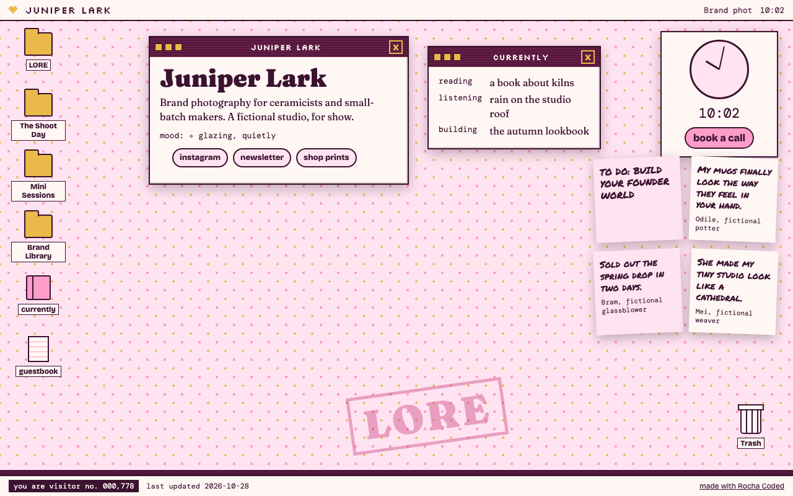
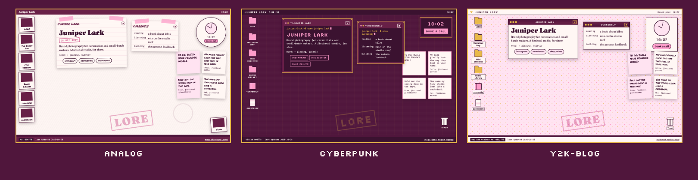
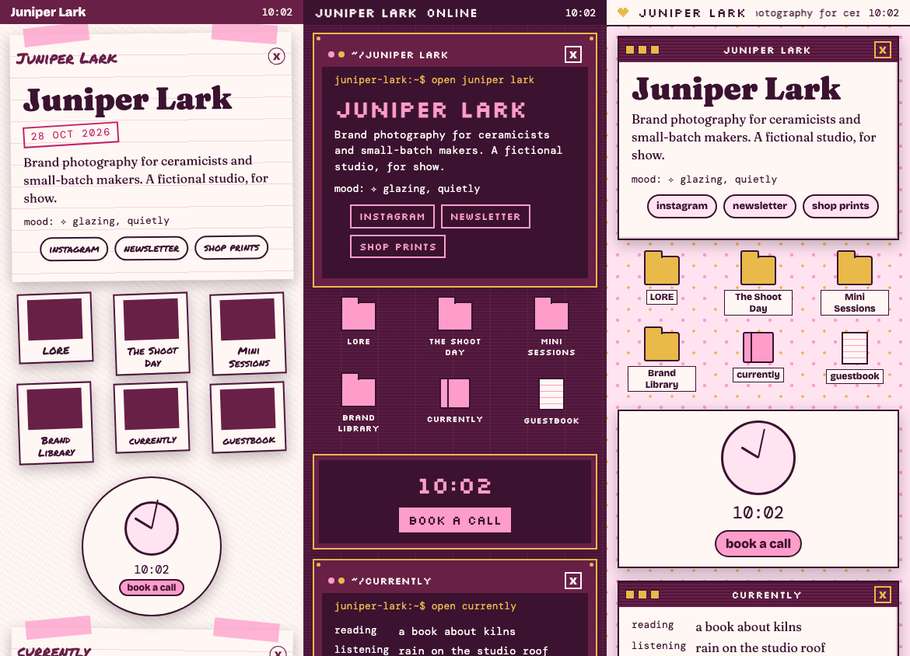

# Desktop Core

*Rocha Coded. Free tools from the Rocheverse.*

**Your link-in-bio as a 2003 desktop.**

Your offers are folders.
Your kind words are sticky notes.
The clock books a call.
The trash holds the things you let go.
There is a guestbook, a "currently" window, a visitor counter, and wallpaper in your colours.
Windows drag and stay where you leave them. On a phone, everything stacks into one tidy column.

<p align="center"></p>

<p align="center"></p>

<p align="center"><sub>One desktop, three moods: analog, cyberpunk, y2k-blog. Juniper Lark is a made-up studio. Every name on it is fictional.</sub></p>

## Start here
You can do this. Each step tells you what to type and what you will see when it worked.

**If you use Claude Code** (Claude in the terminal, the window where you type commands to your computer):

 Open the Terminal app. On a Mac it is in Applications > Utilities > Terminal.
   This checks that Python, the language the tool is written in, is ready:
   ```sh
   python3 --version
   ```
   You will see `Python 3.10` or a higher number.

 This copies the tool onto your computer. "Clone" means download a copy from GitHub, the site where the code lives:
   ```sh
   git clone https://github.com/RochaStone/desktop-core ~/.claude/skills/desktop-core
   ```
   You will see `Cloning into...` and then the line where you type comes back.

 This makes a folder for your desktop and opens Claude Code inside it:
   ```sh
   mkdir -p ~/my-desktop && cd ~/my-desktop && claude
   ```
   You will see Claude Code open and wait for you.

 Type this to Claude, in your own words if you like:
   ```
   Make my link in bio a 2003 desktop.
   ```
   You will see Claude show you the three looks, then ask your first question. It asks one thing at a time.

 When Claude says READY, this opens your desktop in your browser:
   ```sh
   open site/index.html
   ```
   You will see your desktop. Claude then walks you through putting it online on your own free account.

**If you use Claude Cowork** (the Claude desktop app): download the zip (one file that holds the whole tool),
upload it in Customize > Skills, give a task your desktop folder, and say "Make my link in bio a 2003 desktop."
The full steps are under [Claude Cowork](#claude-cowork).

<p align="center"></p>

## What you get
- **Folders for your offers.** Each one opens a window with a few words, a short list and your button.
- **Sticky notes for your testimonials.** Real words from real clients, with their permission.
- **A clock that books a call.** It tells the time and carries your booking link.
- **The trash.** Things I let go. Crossed out, kept on show.
- **A "currently" window.** Reading, listening, building.
- **A guestbook.** It goes wherever you choose: a form, a page, or your email.
- **A visitor counter.** A playful one. It starts at your number and counts visits from each browser. It is a decoration, not analytics.
- **Draggable windows that remember.** Each visitor's browser keeps where they left them. Nothing is sent anywhere.
- **Keyboard friendly.** Tab moves between icons, Enter opens, Escape closes, arrow keys move a window by its title bar.
- **Phone friendly.** At phone width the windows stack in one column, with no sideways scroll.

<p align="center"></p>

<p align="center"></p>

## Install
It runs inside Claude. The tool needs no account. Your finished site goes on your own free GitHub Pages or Vercel.

| Where you use it | Install it | Start it |
|---|---|---|
| [Claude Code](#claude-code) (recommended) | clone into `~/.claude/skills` | ask "make my link in bio a 2003 desktop" |
| [Claude Cowork](#claude-cowork) | upload `desktop-core.zip` as a skill | ask for your desktop in a Cowork task |

You need Python 3.10 or newer. Google Chrome is optional, for the preview pictures and the tests.

### Claude Code
```sh
git clone https://github.com/RochaStone/desktop-core ~/.claude/skills/desktop-core
```
Open Claude Code in the folder where you want your desktop, and ask: "Make my link in bio a 2003 desktop."
To update later: `git -C ~/.claude/skills/desktop-core pull`.

### Claude Cowork
Cowork (the Claude desktop app) runs tasks in a sandbox on your computer that can only reach the folders you give it.
1. Download `desktop-core.zip` from the [latest release](https://github.com/RochaStone/desktop-core/releases/latest).
2. In the Claude desktop app: Customize > Skills, then + > Create skill > Upload a skill, and pick the zip.
3. In Settings > Capabilities, turn on code execution and file creation.
4. Make a folder for your desktop, for example `my-desktop` in your home folder. Start a Cowork task, give it access
   to that folder, and ask: "Make my link in bio a 2003 desktop."

Cowork builds the `site` folder. Putting it online happens in your browser, on GitHub or Vercel, and Claude gives you each click.

<p align="center"></p>

## How to use it
Claude asks you about ten things, one at a time: your name, your line, your offers, your kind words, your booking link,
what you let go of, what you are into right now, your links and your guestbook.
It writes them into `desktop.config.json`, one small file that holds every word on your desktop.
Then it builds your site:
```sh
python3 ~/.claude/skills/desktop-core/build.py desktop.config.json --out site/
```
You will see `READY. Your desktop is in site/`. That folder holds one file, `index.html`, and that file is your whole site.

To put it online ("deploy" means putting the folder on the internet so anyone with the link can see it),
Claude walks you through one of these on your own free account:
- **GitHub Pages.** Make a repository (a folder on GitHub), upload `index.html`, then Settings > Pages > Save. You get a `github.io` link.
- **Vercel.** Drag in the repository, or deploy the `site` folder from the terminal. You get a `vercel.app` link, and you can add your own domain later.

To change anything later, edit `desktop.config.json`, build again, and upload the new `index.html`.

## If it goes wrong (everyone's first time) 
This happens to everyone the first time. Here are the three most common moments and the fix for each.
- **The terminal says `command not found` for `python3` or `git`.** Your Mac may offer to install its developer tools. Click Install, wait for it to finish, and run the step again. If nothing pops up, install Python from python.org.
- **The build says "A few things to fix in your config first".** It lists each one in plain words, like a link missing its `https://`. Fix those lines, or ask Claude to, and build again.
- **Your GitHub Pages link shows a 404 page.** Pages takes a minute or two the first time. Check Settings > Pages says `main` and `/ (root)`, and that `index.html` sits at the top of the repository, then refresh.

<p align="center"></p>

## Make it yours
Your look lives in one file, `style.json`: your colours, your fonts, and one stamp word for your wallpaper.
It ships with two examples: `examples/style.rocha-coded.json` (my plum and blush) and a blank `style.example.json` for yours, explained in `STYLE.md`. Or ask Claude to make one with you from a few references.
Pick your motif, `analog`, `cyberpunk` or `y2k-blog`, to change the structure. Your palette and fonts re-tone all three, so every version is yours to curate.
The same file works across every Rocha Coded tool, so you make it once.

## What's inside
| File | What it does |
|---|---|
| `SKILL.md` | the steps Claude follows: the three looks, the interview, the build, putting it online |
| `index.html` | the whole site in one file, no framework. It draws all three motifs from one function |
| `desktop.config.json` | the fictional example: every word on the desktop. Yours replaces it |
| `build.py` | checks your config, finds your style, and writes `site/index.html` |
| `scripts/render.py` | headless Chrome helpers for the pictures and the phone-width checks |
| `scripts/make-readme-images.py` | makes every image in this README from the tool itself, listed in `docs/IMAGES.md` |
| `tests/` | the tests, and `tests/TESTING.md` with exactly what was run |
| `examples/`, `style.example.json`, `STYLE.md` | Rocha's example style, your blank one, and what each key does |

Everything is plain Python from the standard library and plain HTML. No packages to install.
The page loads its fonts from Google Fonts and falls back to fonts already on the computer when offline.

For the curious, try another look by hand:
```sh
python3 build.py desktop.config.json --out site/ --motif cyberpunk
```
Or open `index.html` from this folder with `?motif=analog` on the end of the address.

## Licence
MIT. See [LICENSE](LICENSE). Copyright (c) 2026 Rochelle Livingstone / Thriving Era Studio.

 [Sign my guestbook](https://github.com/RochaStone/desktop-core/issues)

## Made by Rocha

Rocha \
Brand Alchemist & AI Architect \
Author of *Brand Alchemy in the Thriving Era* and *Thriving in Transformational Times* \
Creator of [Conscious Founder Operating System](https://founders.thrivingera.com) \
Founder, [Thriving Era Studio](https://thrivingera.com)

I help female founders build their founder world, and I build what they need next. \
Start with the audit: [thrivingera.com/audit](https://thrivingera.com/audit). \
Or book an exploratory call: [calendly.com/rochelle-thrivingera/exploratory-call](https://calendly.com/rochelle-thrivingera/exploratory-call). It is where we decide if we work together.

[Instagram @rocheverse](https://instagram.com/rocheverse) · [Substack](https://rochastone.substack.com) · [LinkedIn](https://www.linkedin.com/in/rochellelivingstonecosmic) · [More free tools](https://thrivingera.com/free) · [All tools on GitHub](https://github.com/RochaStone)
